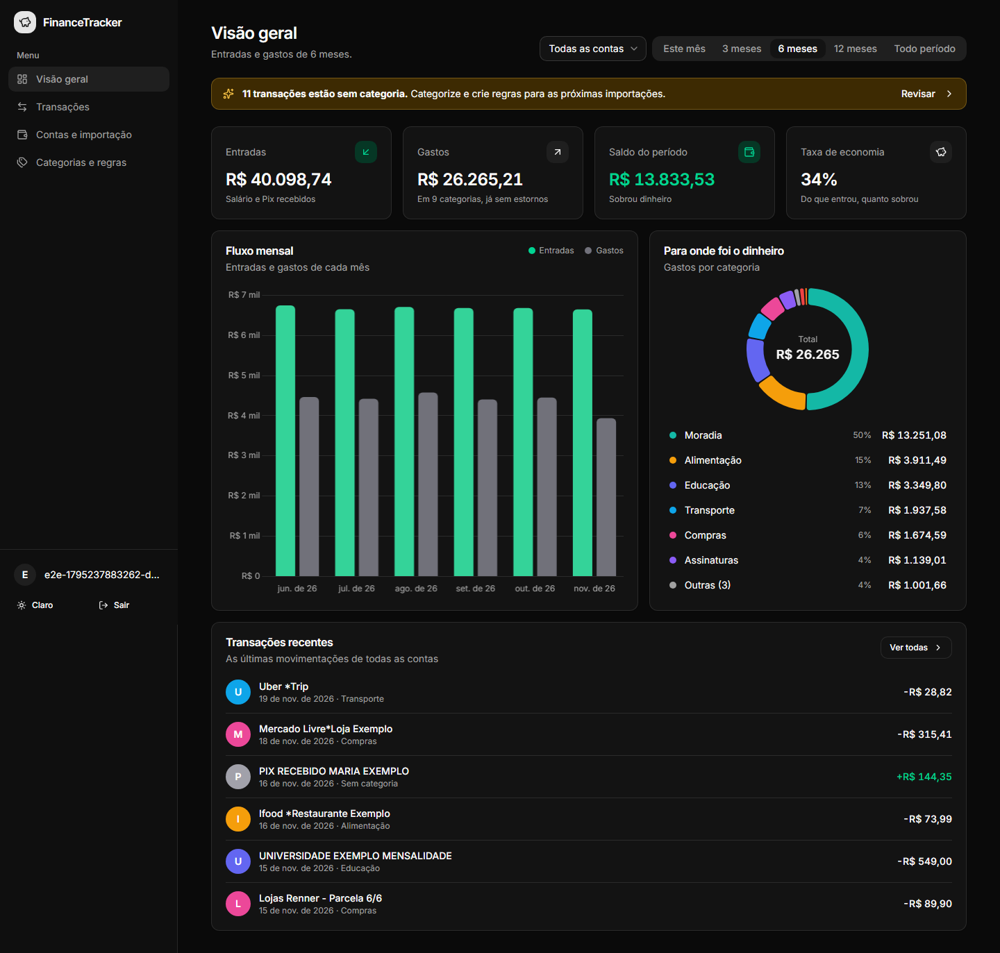
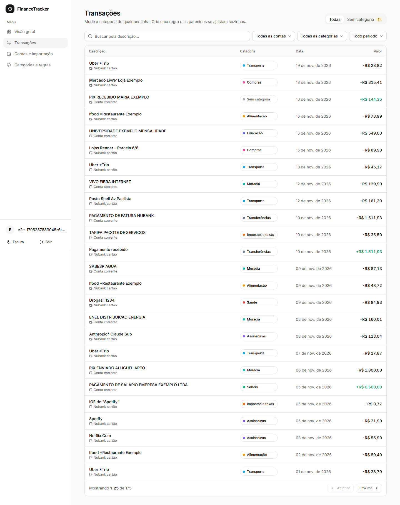
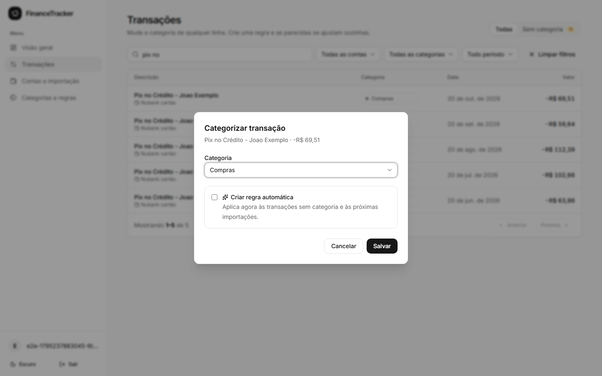
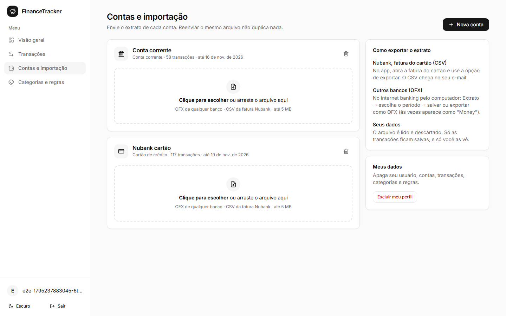
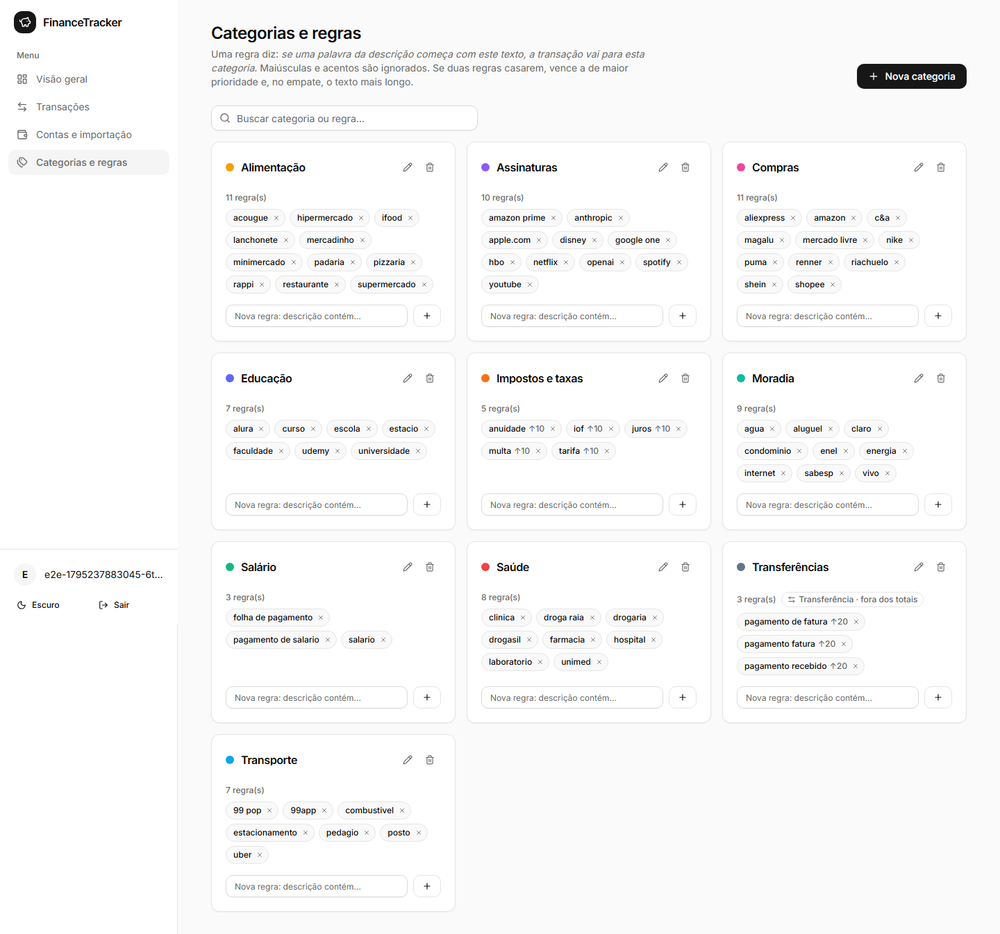

# FinanceTracker

Todo mês a fatura chega e a pergunta é a mesma: para onde foi o dinheiro?

O FinanceTracker responde isso sem planilha. Você envia o extrato do banco, ele organiza os gastos por categoria e mostra o mês em um painel simples.


## O que ele faz

- Lê extratos **OFX** de qualquer banco e o **CSV da fatura do Nubank**.
- Categoriza sozinho e aprende quando você corrige uma transação.
- Não duplica nada se o mesmo arquivo for enviado de novo, e uma importação errada pode ser desfeita.
- Não conta o pagamento da fatura como gasto, e estorno volta a reduzir o que você gastou.
- Funciona no celular, tem tema escuro e cada usuário vê apenas os próprios dados.

<details>
<summary>Ver mais telas</summary>

| | |
|---|---|
|  |  |
|  |  |
|  |  |

</details>

## Feito com

C# e ASP.NET Core (.NET 10), EF Core, SQL Server, Angular, Tailwind CSS, Chart.js, xUnit e Playwright.

As decisões do projeto, com o porquê de cada uma, estão em [`docs/adr`](docs/adr).

## Como rodar

Você vai precisar do .NET 10, Node 24+ e SQL Server Express (instância `.\SQLEXPRESS`).

```bash
dotnet tool restore
dotnet ef database update -p src/FinanceTracker.Infrastructure -s src/FinanceTracker.Api
dotnet user-secrets set "Jwt:Key" "<texto aleatório com 32+ caracteres>" --project src/FinanceTracker.Api
dotnet run --project src/FinanceTracker.Api --launch-profile http
```

Em outro terminal:

```bash
cd web
npm install
npm start
```

Abra http://localhost:4200, crie uma conta e teste com os extratos fictícios da pasta [`samples`](samples).

## Testes

```bash
dotnet test
cd web && npx playwright install chromium && npx playwright test
```
