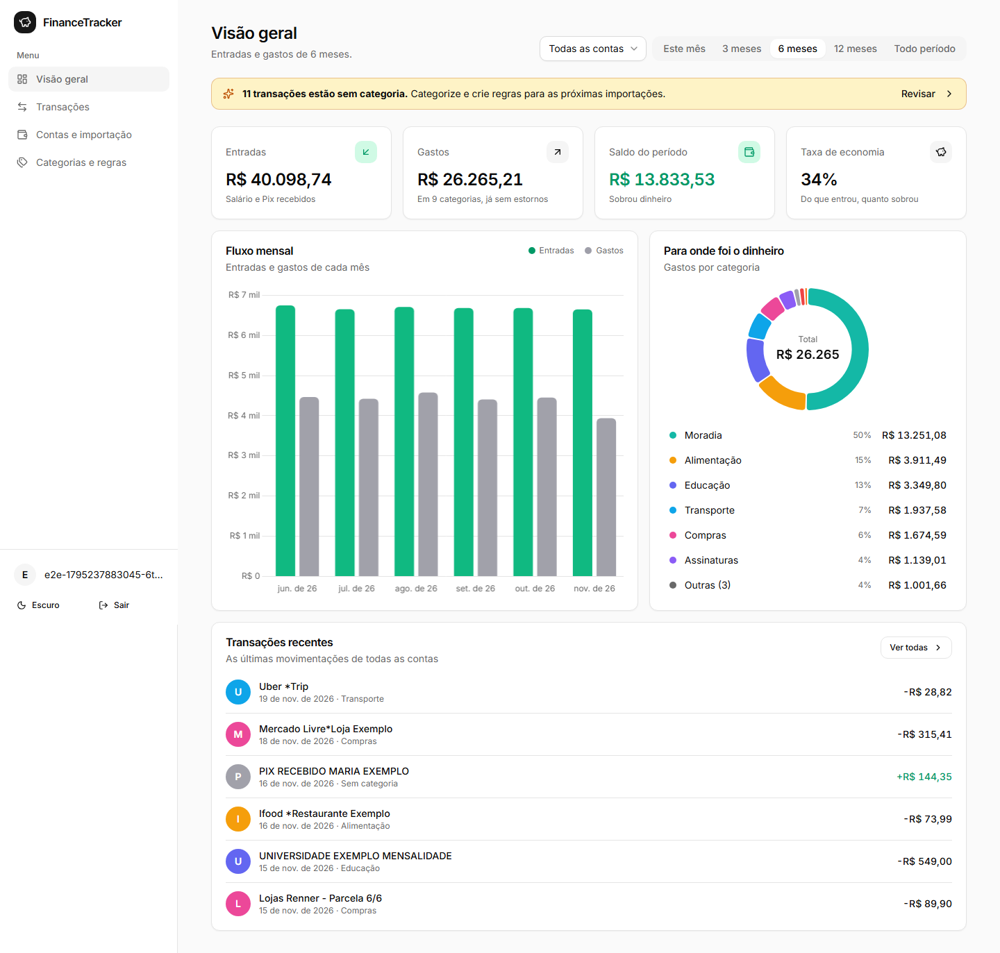

# FinanceTracker

Aplicação de controle financeiro pessoal. Importa extratos bancários, categoriza as transações e mostra entradas e gastos por período.



## Funcionalidades

- Importação de extratos OFX e CSV da fatura do Nubank
- Categorização automática por regras
- Reimportação sem duplicar transações
- Opção de desfazer uma importação
- Painel com entradas, gastos, saldo e gastos por categoria
- Login com dados separados por usuário
- Tema claro e escuro, com layout para celular

## Stack

- **Back-end:** C#, ASP.NET Core (.NET 10), EF Core e SQL Server
- **Front-end:** Angular, Tailwind CSS e Chart.js
- **Testes:** xUnit e Playwright

As decisões de arquitetura estão em [`docs/adr`](docs/adr).

## Como rodar

Pré-requisitos: .NET 10, Node 24+ e SQL Server Express na instância `.\SQLEXPRESS`.

```bash
dotnet tool restore
dotnet ef database update -p src/FinanceTracker.Infrastructure -s src/FinanceTracker.Api
dotnet user-secrets set "Jwt:Key" "<texto aleatório com 32+ caracteres>" --project src/FinanceTracker.Api
dotnet run --project src/FinanceTracker.Api --launch-profile http
```

Em outro terminal:

```bash
cd web
npm install
npm start
```

A aplicação fica em http://localhost:4200. A pasta [`samples`](samples) tem extratos fictícios para teste.

## Testes

```bash
dotnet test
cd web
npx playwright install chromium
npx playwright test
```
